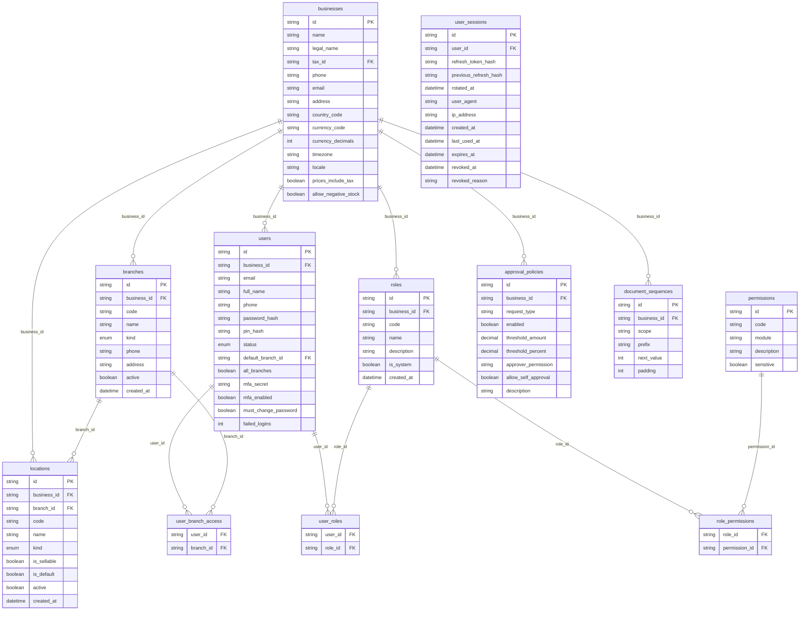
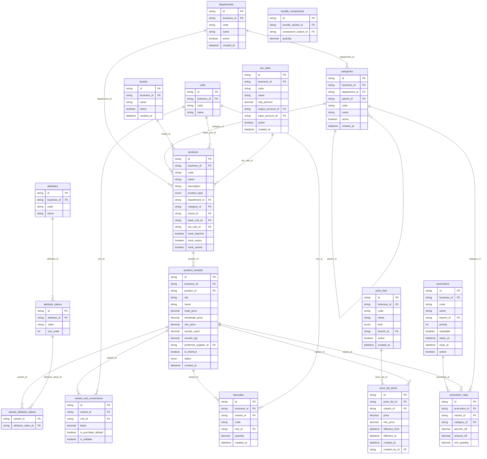
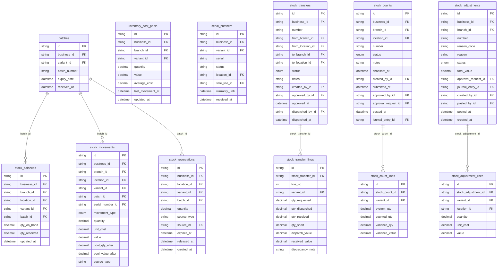
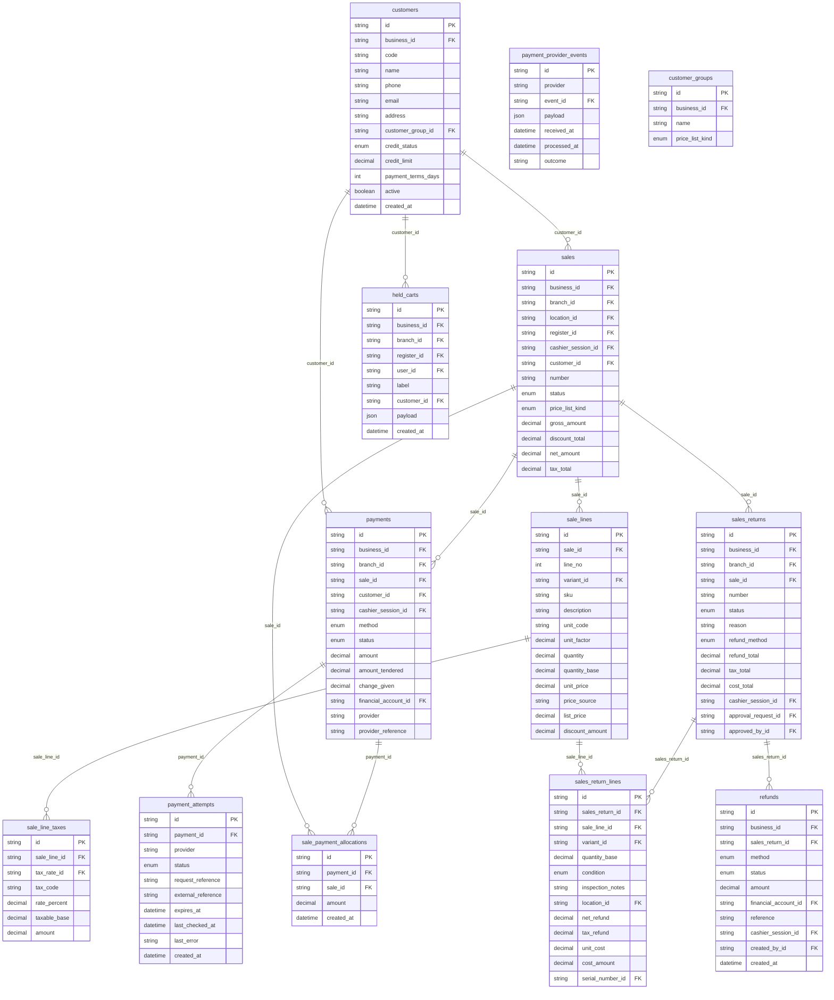
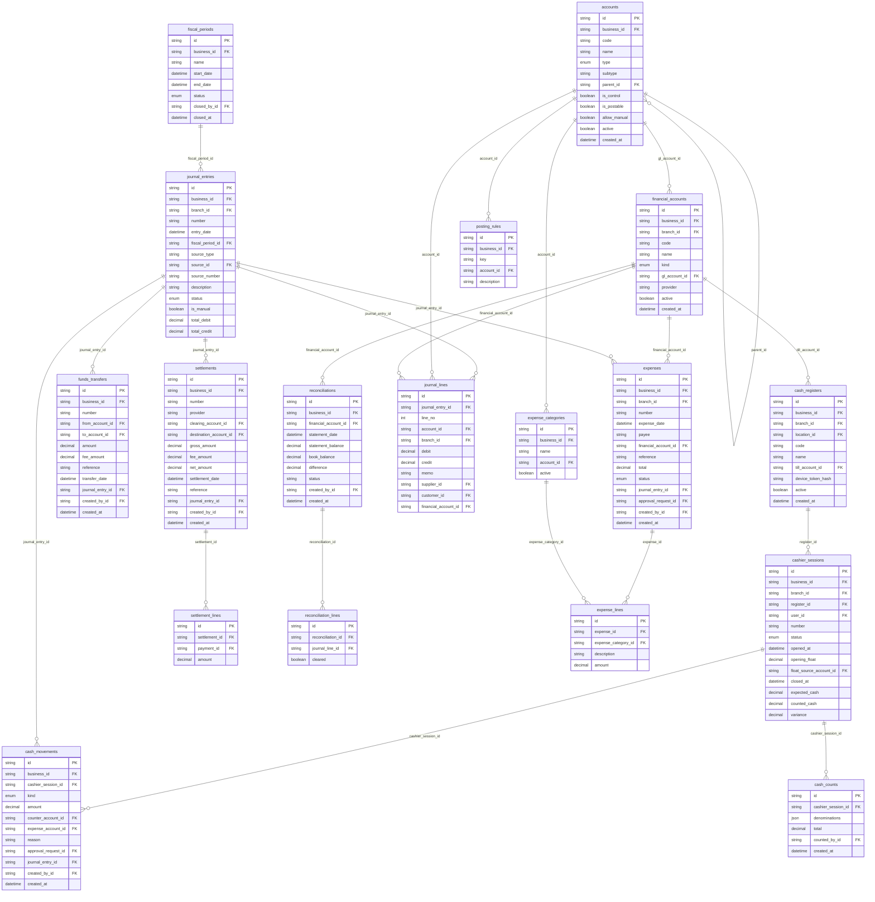
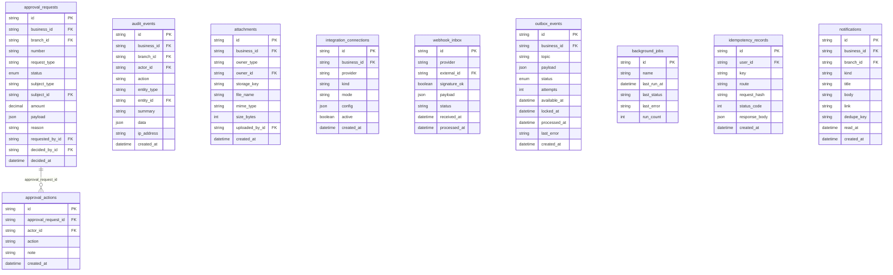

# Entity relationship diagrams

_Generated by `pnpm --filter @retail/db erd` from `database/prisma/schema.prisma`. Do not edit by hand._

Every `*_id` column has a real foreign key (ON DELETE RESTRICT). `created_by_id`-style user references are omitted from diagrams for readability.

## Organisation and access

## Catalogue

## Purchasing

```mermaid
erDiagram
  suppliers {
    string id PK
    string business_id FK
    string code
    string name
    string contact_name
    string phone
    string email
    string address
    string tax_id FK
    int payment_terms_days
    boolean active
    datetime created_at
  }
  purchase_orders {
    string id PK
    string business_id FK
    string branch_id FK
    string supplier_id FK
    string number
    enum status
    enum receipt_status
    enum invoice_status
    datetime order_date
    datetime expected_date
    string payment_type
    string notes
    decimal subtotal
    decimal tax_total
  }
  suppliers ||--o{ purchase_orders : "supplier_id"
  purchase_order_lines {
    string id PK
    string purchase_order_id FK
    int line_no
    string variant_id FK
    string unit_id FK
    decimal unit_factor
    decimal quantity
    decimal quantity_base
    decimal unit_cost
    string tax_rate_id FK
    decimal tax_percent
    decimal line_subtotal
    decimal line_tax
    decimal received_base
  }
  purchase_orders ||--o{ purchase_order_lines : "purchase_order_id"
  goods_receipts {
    string id PK
    string business_id FK
    string branch_id FK
    string location_id FK
    string supplier_id FK
    string purchase_order_id FK
    string number
    enum status
    string supplier_reference
    datetime received_at
    string notes
    decimal total_value
    datetime posted_at
    string posted_by_id FK
  }
  suppliers ||--o{ goods_receipts : "supplier_id"
  purchase_orders ||--o{ goods_receipts : "purchase_order_id"
  goods_receipt_lines {
    string id PK
    string goods_receipt_id FK
    string purchase_order_line_id FK
    int line_no
    string variant_id FK
    string unit_id FK
    decimal unit_factor
    decimal qty_accepted
    decimal qty_damaged
    decimal qty_rejected
    decimal accepted_base
    decimal damaged_base
    decimal rejected_base
    decimal unit_cost
  }
  goods_receipts ||--o{ goods_receipt_lines : "goods_receipt_id"
  purchase_order_lines ||--o{ goods_receipt_lines : "purchase_order_line_id"
  supplier_invoices {
    string id PK
    string business_id FK
    string branch_id FK
    string supplier_id FK
    string number
    string supplier_invoice_no
    datetime invoice_date
    datetime due_date
    enum status
    decimal subtotal
    decimal tax_total
    decimal total
    decimal amount_paid
    string notes
  }
  suppliers ||--o{ supplier_invoices : "supplier_id"
  supplier_invoice_lines {
    string id PK
    string supplier_invoice_id FK
    int line_no
    string goods_receipt_line_id FK
    string variant_id FK
    string description
    decimal quantity_base
    decimal base_unit_cost
    decimal line_subtotal
    string tax_rate_id FK
    decimal line_tax
    string expense_account_id FK
  }
  supplier_invoices ||--o{ supplier_invoice_lines : "supplier_invoice_id"
  goods_receipt_lines ||--o{ supplier_invoice_lines : "goods_receipt_line_id"
  invoice_receipt_matches {
    string id PK
    string supplier_invoice_line_id FK
    string goods_receipt_line_id FK
    decimal quantity_base
    decimal receipt_value
    decimal invoice_value
    decimal price_variance
    datetime created_at
  }
  goods_receipt_lines ||--o{ invoice_receipt_matches : "goods_receipt_line_id"
  supplier_payments {
    string id PK
    string business_id FK
    string branch_id FK
    string supplier_id FK
    string number
    datetime payment_date
    string financial_account_id FK
    decimal amount
    decimal unallocated
    string reference
    enum status
    string journal_entry_id FK
    string created_by_id FK
    datetime created_at
  }
  suppliers ||--o{ supplier_payments : "supplier_id"
  supplier_payment_allocations {
    string id PK
    string supplier_payment_id FK
    string supplier_invoice_id FK
    decimal amount
    datetime created_at
  }
  supplier_payments ||--o{ supplier_payment_allocations : "supplier_payment_id"
  supplier_invoices ||--o{ supplier_payment_allocations : "supplier_invoice_id"
  supplier_credit_notes {
    string id PK
    string business_id FK
    string supplier_id FK
    string number
    string purchase_return_id FK
    decimal amount
    enum status
    string journal_entry_id FK
    datetime created_at
  }
  suppliers ||--o{ supplier_credit_notes : "supplier_id"
  purchase_returns {
    string id PK
    string business_id FK
    string branch_id FK
    string supplier_id FK
    string number
    enum status
    string reason
    decimal total_value
    string journal_entry_id FK
    string created_by_id FK
    datetime created_at
  }
  suppliers ||--o{ purchase_returns : "supplier_id"
  purchase_return_lines {
    string id PK
    string purchase_return_id FK
    string goods_receipt_line_id FK
    string variant_id FK
    string location_id FK
    decimal quantity_base
    decimal unit_cost
    decimal value
  }
  purchase_returns ||--o{ purchase_return_lines : "purchase_return_id"
  goods_receipt_lines ||--o{ purchase_return_lines : "goods_receipt_line_id"
  landed_cost_documents {
    string id PK
    string business_id FK
    string number
    string goods_receipt_id FK
    string allocation_method
    decimal amount
    enum status
    string journal_entry_id FK
    datetime created_at
  }
  goods_receipts ||--o{ landed_cost_documents : "goods_receipt_id"
  landed_cost_allocations {
    string id PK
    string landed_cost_document_id FK
    string goods_receipt_line_id FK
    decimal amount
    decimal to_inventory
    decimal to_expense
  }
  landed_cost_documents ||--o{ landed_cost_allocations : "landed_cost_document_id"
  goods_receipt_lines ||--o{ landed_cost_allocations : "goods_receipt_line_id"
```

## Inventory

## Sales and customers

## Finance and accounting

## Governance and integration

